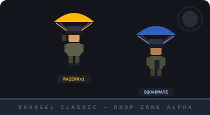
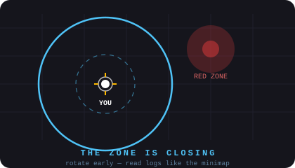

<div align="center">


</div>

<div align="center">


</div>

<br/>

<div align="center">

[](https://linkedin.com/in/bhargav-haldipur)
[](mailto:bhargav.haldipur2004@gmail.com)
[](https://github.com/Razer0x1)
[](#)

</div>

<div align="center">



</div>

---

> 🪂 **The blue zone is closing in — 100 players drop, only one walks out.**
> I run every ticket, incident, build and release the same way: **Recon, Loot, Rotate, Win.**

<div align="center">



</div>

---

## 🎮 Player Card

```python
class Player:
    ign          = "Razer0x1"
    real_name    = "Bhargav Haldipur"
    role         = "Support Engineer → Fragger (Backend)"   # support who can frag too
    drop_zone    = "Bengaluru, Karnataka, India 🇮🇳"

    loadout = ["Python", "PHP", "MySQL", "JavaScript", "REST APIs",
               "FastAPI", "SQLAlchemy", "Docker"]

    matches_played = {          # career log (full report below)
        "BlackBuck":  "Feb 2024 – Present",
        "ARSS":       "Feb 2025 – Present",
        "Effort":     "2025",
        "Cognifyz":   "Aug 2025 – Sep 2025",
    }
    battle_rewards = 3          # certificates unlocked 🏅
    edu_unlocks    = ["BCA (CGPA 7.75)", "High School"]

    currently_training = ["System Design", "TypeScript", "Backend Architecture"]
    current_tier       = "Diamond III → grinding for CONQUEROR (Backend Engineering)"
    fun_fact           = "Heals the squad at work and heals side projects at 2AM 🌙"
```

---

## 🎒 Loadout

<div align="center">

### 🔫 Primary


### 🪖 Secondary


### 💣 Utility


### 👕 Skins


</div>

---

## 🪂 Airdrops (Projects)

<table>
<tr>
<td width="50%" valign="top">

### 🇮🇳 [Bharat Biz OS](https://github.com/Razer0x1/bharat-biz-os)  · TIER: MYTHIC
> React 19 · TypeScript · Supabase · Gemini AI · FastAPI

**AI-powered business OS for Indian MSMEs.**
CRM, GST billing, inventory, analytics & AI insights — now with a production-twinned **async FastAPI backend** (SQLAlchemy 2.0, Alembic, Docker, 30 tests green).

`React` `TypeScript` `Supabase` `Gemini AI` `FastAPI`

</td>
<td width="50%" valign="top">

### 🎫 [Northwind Helpdesk](https://github.com/Razer0x1/Northwind-Helpdesk)  · TIER: EPIC
> FastAPI · SQLAlchemy 2.0 · Alembic · Docker

**Helpdesk/CRM backend, rebuilt as a production service.**
Ticket lifecycle, SLA tiers, agent workload metrics, audit trail — 32 tests green, Ruff clean, one-command containers.

`FastAPI` `SQLAlchemy` `Alembic` `pytest`

</td>
</tr>
<tr>
<td width="50%" valign="top">

### 👕 [WASHTAG](https://github.com/Razer0x1/WASHTAG)  · TIER: EPIC
> PHP · MySQL · Bootstrap · JavaScript

**Full-stack laundry management platform.**
Online booking, order tracking, admin dashboard, multi-role access — normalized 8-table schema.

`PHP` `MySQL` `JavaScript` `Bootstrap`

</td>
<td width="50%" valign="top">

### 🌐 [Portfolio](https://github.com/Razer0x1/Portfolio)  · TIER: RARE
> FastAPI · httpx · Async

**Personal site backend with a status checker.**
URL health checks with SSRF hardening, rate limiting, honeypot escaping, contact persistence — 31 tests green.

`FastAPI` `httpx` `Rate Limiting`

</td>
</tr>
</table>

---

## 🏆 Match History (Experience)

<div align="center">

| Result | Role | Squad (Org) | Season |
|---|------|-------------|--------|
| 🟩 **Active** | **Technical Support Engineer** | **BlackBuck Ltd.**, Bengaluru | Feb 2024 – Present |
| 🟩 **Active** | **Software Tester** | **ARSS Software Solution** | Feb 2025 – Present |
| 🟨 **Cleared** | **Associate Category Support** | **Effort Consultancy Services** | 2025 |
| 🟨 **Top 10** | **Web Development Intern** | **Cognifyz Technologies** (remote) | Aug 2025 – Sep 2025 |

</div>

- 🎧 **BlackBuck** — frontline ops for live GPS fleets: SQL digs on shipment data, API log traces, incident queues. Never left the final circle in 1+ year.
- 🧪 **ARSS Software Solution** — sweep builds before they drop into prod: manual test scenarios, regression checklists, repro-clean bug reports.
- 📦 **Effort Consultancy Services** — category support ops: ticket triage, follow-ups, and data upkeep in tight daily rotations.
- 💻 **Cognifyz Technologies** — web dev internship: CSS/JS feature fixes, UI polish, early Python reps. Earned the internship certificate.

---

## 🏅 Battle Rewards (Licenses & Certifications)

<table>
<tr><td width="60%" valign="top">

- 🏅 **GST Exchange Inclusion 2025 — Certificate of Participation** · *IICSM · 2025* — team-collab hackathon-style participation across a 12+ member cohort
- 🏅 **Deloitte Australia — Data Analytics Job Simulation** · *Forage · Jan 2025* — data analysis, dashboards & insight-telling simulation track
- 🏅 **Web Development Internship Certificate** · *Cognifyz Technologies · 2025*

</td><td width="40%" valign="top">

```
  [🏆.EXE RUNNING]
  3/3 rewards collected
  progress ██████████ 100%

  next unlock:
  · Backend eng role 🎯
  · Conqueror tier 🏆
```

</td></tr>
</table>

---

## 🎓 Training Grounds (Education)

- 🎓 **BCA — Computer Applications** · *Computer Education & Programming College, Karnataka* · **2021–2024** · CGPA **7.75/10**
- 🏫 **St. Joseph High School, Karnataka** · **2017–2020**

```
RANK PROGRESS
─────────────────────────────────────────────
Python          ████████████████░░░░  ·  Diamond
SQL / Databases ███████████████░░░░░  ·  Diamond
FastAPI backend ████████████░░░░░░░░  ·  Platinum
System Design   █████████░░░░░░░░░░░  ·  Gold
                grinding → CONQUEROR 🏆
```

---

## 📊 Stat Tracker

<div align="center">


</div>

<div align="center">


</div>

<div align="center">


</div>

<div align="center">

### 🏅 Achievements Unlocked


</div>

<div align="center">

### 🐍 The Snake Survives On My Commits


</div>

---

## 🤝 Squad Up

<div align="center">

Hiring for **Backend / Software Engineering**? Building something worth dropping into? Join my squad.

[](https://linkedin.com/in/bhargav-haldipur)
[](mailto:bhargav.haldipur2004@gmail.com)

</div>

<br/>

<div align="center">


</div>

<div align="center">


</div>
